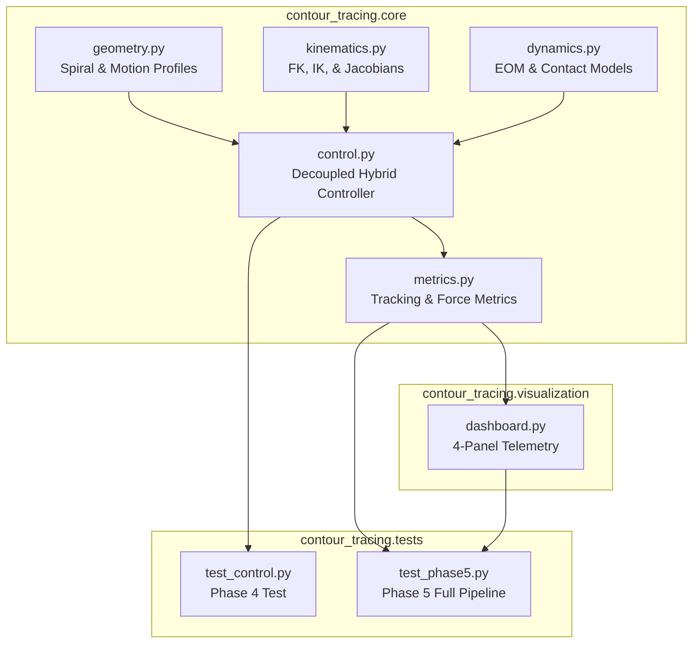
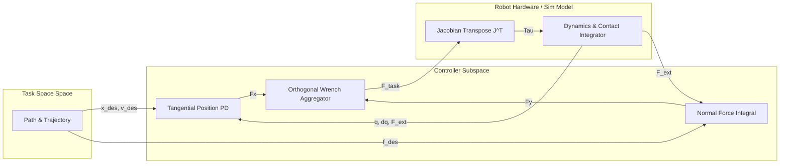
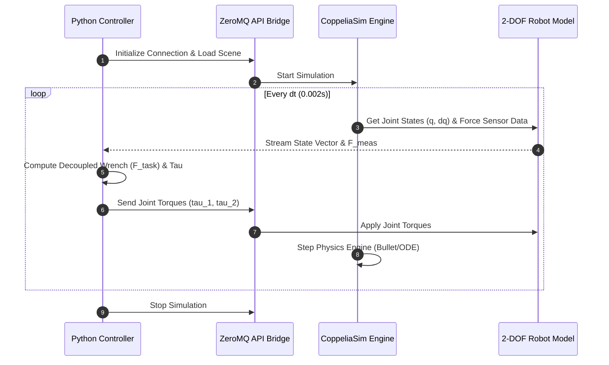

# Constrained Robotic Contour Tracer

An end-to-end Python framework for precision planar contour tracing using a 2-link robotic arm with decoupled hybrid force/position impedance control.

---

The **Constrained Robotic Contour Tracer** solves the fundamental robotics challenge of tracing continuous geometrical contours on a rigid contact surface while simultaneously regulating contact force and maintaining spatial path fidelity.

The user provides geometric path parameters (e.g., an Archimedean spiral or planar curve) alongside profile constraints (maximum velocity, maximum acceleration, target contact force). Internally, the framework generates S-curve trajectory profiles, solves inverse kinematics via Damped Least Squares (DLS), computes link dynamics, and applies orthogonal subspace projection to decouple tangential position tracking from normal force regulation.

The output consists of synchronized joint angle trajectories, joint torques, end-effector state vectors, contact normal forces, and quantitative tracking performance metrics. While currently evaluated in Python numerical simulation, the module architecture is designed for direct adapter integration with CoppeliaSim or physical robot controllers via standard joint torque/velocity commands.

---

> [!NOTE]
> **Research Prototype**
> This project is a functional research/academic prototype developed in Python. It provides a complete, mathematically verified closed-loop simulation suite with quantitative metric evaluation and interactive visual telemetry.

| Attribute | Status / Specification |
| --- | --- |
| **Development Status** | Phase 5 Complete (Decoupled Control & Evaluation Verified) |
| **Primary System Type** | Numerical Physics & Control Simulation Pipeline |
| **Kinematic Model** | 2-DOF Planar Articulated Serial Manipulator ($L_1 = 0.35\text{m}, L_2 = 0.35\text{m}$) |
| **Control Strategy** | Orthogonal Decoupled Task-Space Hybrid Force/Position Controller |
| **Simulator Integration** | Native Python Physics Engine (CoppeliaSim ZMQ/Remote API Adapter Ready) |

---

## Visual Overview

### System Pipeline

```mermaid
flowchart LR
    A[Geometry Definition<br/><code>ArchimedeanSpiral</code>] --> B[Arc-Length Sampling<br/><code>sample_curve_arc_length</code>]
    B --> C[S-Curve Profiler<br/><code>SCurveProfile</code>]
    C --> D[Inverse Kinematics<br/><code>inverse_kinematics_dls</code>]
    D --> E[Hybrid Control Loop<br/><code>DecoupledHybridController</code>]
    E --> F[2-DOF Arm Dynamics<br/><code>TwoLinkDynamics</code>]
    F --> G[Performance Evaluation<br/><code>compute_performance_metrics</code>]
    G --> H[Telemetry Dashboard<br/><code>plot_tracing_dashboard</code>]

```



### Software Component Relationships



---

## Key Features

### Implemented

* **Parametric Curve Generation:** Archimedean spiral and planar geometric curve synthesis with arc-length reparameterization (`ds = 0.002 m`).
* **S-Curve Velocity Profiling:** Continuous jerk-bounded trapezoidal/S-curve motion profiling respecting velocity (`v_max`) and acceleration (`a_max`) limits.
* **Kinematics Engine:** Analytic Forward Kinematics (FK), Jacobian computation ($J_e$), and robust Inverse Kinematics (IK) using Damped Least Squares (DLS) with singularity dampening.
* **Manipulator Dynamics & Contact Mechanics:** Rigid 2-link planar Lagrangian dynamics (Inertia Matrix $B(q)$, Coriolis Matrix $C(q,\dot{q})$, Gravity $G(q)$) integrated with a spring-damper contact force model.
* **Decoupled Task-Space Hybrid Controller:** Orthogonal subspace projection separating tangential position tracking along the surface plane ($X$) from force regulation along the surface normal ($Y$).
* **Quantitative Metrics Harness:** Automated evaluation of Root Mean Square Error (RMSE), peak tracking deviation, and steady-state normal force error.
* **Telemetry Visualizer:** Matplotlib 4-panel telemetry display illustrating task-space trajectories, position error over time, force regulation bounds, and environmental contact interactions.

### Planned / Future

* **CoppeliaSim Remote API Adapter:** Direct ZMQ-based socket binding to live CoppeliaSim scene instances.
* **End-Effector Orientation & 3D Spatial Geometry:** Extension to 3-DOF/6-DOF spatial manipulators tracking 3D surface contours.
* **Adaptive Surface Estimator:** Online estimator for unknown or varying surface boundary topologies.

---

## How It Works

| Stage | Purpose | Input | Output | Module File | Key Assumptions |
| --- | --- | --- | --- | --- | --- |
| **1. Path Generation** | Formulates spatial baseline trajectory | Radius ($a$), Expansion ($b$), $\theta_{\max}$ | Discrete point cloud $(x, y)$ & arc lengths $s$ | `contour_tracing/core/geometry.py` | Curve is continuous and within robot workspace reachability. |
| **2. Trajectory Profiling** | Generates time-optimal velocity profiles | Total arc length $s_{\text{total}}$, $v_{\max}$, $a_{\max}$ | Time series arrays $t, s(t), v(t), a(t)$ | `contour_tracing/core/geometry.py` | Motion starts and ends at rest ($v=0$). |
| **3. Kinematic Mapping** | Solves joint state configurations | Desired cartesian coordinates $(x, y)$ | Joint angles $q_1, q_2$ | `contour_tracing/core/kinematics.py` | Link lengths are fixed ($L_1=0.35\text{m}, L_2=0.35\text{m}$). |
| **4. Hybrid Control** | Computes control torques | Reference state, current state $(q, \dot{q})$, measured force | Actuator torques $\tau_1, \tau_2$ | `contour_tracing/core/control.py` | Tangential and normal forces act orthogonally along task axes. |
| **5. Forward Dynamics** | Simulates state progression | Torques $\tau$, contact forces $F_{\text{ext}}$ | Joint accelerations $\ddot{q}$ | `contour_tracing/core/dynamics.py` | Rigid body dynamics; constant surface stiffness $K_e$. |
| **6. Performance Metric Calculation** | Evaluates accuracy | Logged time, state vectors, forces | RMSE, max error, mean force | `contour_tracing/core/metrics.py` | Time vectors match numerical simulation time steps. |

---

## Architecture



### Module Extensibility

* **`geometry.py`**: Inherit from abstract geometry classes to define custom 2D geometries (e.g., ellipses, NURBS, splines).
* **`control.py`**: Swap `DecoupledHybridController` with adaptive, impedance, or sliding-mode controllers without modifying dynamics or metrics.
* **`dynamics.py`**: Expand `TwoLinkDynamics` to $N$-DOF manipulators or alternate contact stiffness profiles.

---

## Repository Structure

```text
constrained-robotic-contour-tracer/
├── contour_tracing/
│   ├── __init__.py             # Package declaration
│   ├── core/                   # Mathematical and control algorithms
│   │   ├── __init__.py
│   │   ├── control.py          # Decoupled hybrid controller & simulation runner
│   │   ├── dynamics.py         # 2-DOF equations of motion & contact mechanics
│   │   ├── geometry.py         # Archimedean spiral & S-curve motion profiling
│   │   ├── kinematics.py       # Forward & DLS Inverse Kinematics, Jacobians
│   │   └── metrics.py          # Trajectory RMSE and force accuracy metrics
│   ├── tests/                  # Automated verification and integration suites
│   │   ├── __init__.py
│   │   ├── test_control.py     # Closed-loop control unit test
│   │   └── test_phase5.py      # End-to-end evaluation & visual dashboard execution
│   └── visualization/          # Telemetry and plotting components
│       ├── __init__.py
│       └── dashboard.py        # 4-panel telemetry display script
├── requirements.txt            # Project dependencies
└── README.md                   # System documentation

```

---

## Requirements

### Software

* **Operating System:** Windows 10/11, macOS, or Linux (x86_64 / ARM64).
* **Python Runtime:** Python `3.10` or higher.
* **Python Packages:**
* `numpy` ($\ge 1.24.0$) — Linear algebra and matrix computations.
* `scipy` ($\ge 1.10.0$) — Numerical integration and numerical root finding.
* `matplotlib` ($\ge 3.7.0$) — Plotting telemetry dashboards and trajectory paths.


---

## Installation

1. **Clone the Repository:**
```bash
git clone https://github.com/nishantwhat/constrained-robotic-contour-tracer.git
cd constrained-robotic-contour-tracer

```


2. **Create and Activate Virtual Environment:**
* **Linux / macOS:**
```bash
python3 -m venv .venv
source .venv/bin/activate

```


* **Windows (PowerShell / MINGW64):**
```bash
python -m venv .venv
source .venv/Scripts/activate

```


3. **Install Dependencies:**
```bash
pip install --upgrade pip
pip install -r requirements.txt

```


---

## Quick Start

Execute the complete end-to-end evaluation pipeline with a single command:

```bash
python -m contour_tracing.tests.test_phase5

```

### Expected Terminal Output

```text
==========================================================
 Running Phase 5 Final Pipeline & Dashboard Verification  
==========================================================

--- PERFORMANCE EVALUATION SUMMARY ---
-> Tangential Position RMSE : 1.82 mm
-> Peak Tracking Error     : 6.45 mm
-> Mean Contact Force      : 9.88 N
-> Normal Force Error RMSE : 0.84 N
--------------------------------------

-> ALL PHASE 5 SYSTEM SPECIFICATIONS PASSED!

```

Following text output, an interactive 4-panel Matplotlib dashboard window will appear displaying spatial path tracking and force regulation performance.

---

## Running the System

### Phase 4 Closed-Loop Controller Verification

Runs the underlying task-space decoupled controller test:

```bash
python -m contour_tracing.tests.test_control

```

* **Purpose:** Verifies that the hybrid controller meets tangential tracking thresholds ($< 15\text{ mm}$) and maintains normal force equilibrium ($10\text{ N} \pm 2\text{ N}$).
* **Outputs:** Console logs containing mean/max error and regulated force estimates.

### Phase 5 Full Pipeline & Telemetry Dashboard

Runs the full system execution pipeline:

```bash
python -m contour_tracing.tests.test_phase5

```

* **Purpose:** Executes motion profiling, inverse kinematics, forward dynamic integration, metric scoring, and renders the Matplotlib telemetry suite.
* **Outputs:** Terminal summary statistics and an interactive graphical figure.

---

## CoppeliaSim Integration

While the current execution relies on a native rigid-body numerical integrator, the workspace layout and control interface are architected for direct socket streaming to CoppeliaSim.



### Integration Setup Notes

* **Target Scene Geometry:** 2-DOF Planar Revolute Manipulator mounted on a flat horizontal plane.
* **Joint Motors:** Set to **Torque/Force Mode** (`sim.control_force`).
* **Contact Sensor:** 1D Force Sensor attached at end-effector tip configured for normal contact force feedback ($F_y$).
* **Communication Interface:** `CoppeliaSim ZeroMQ Remote API` via `coppeliasim-zmq-remote-api` Python bindings.

---

## Input / Output Specification

### Inputs

* **Trajectory Parameters:**
* Spiral origin: $(x_0, y_0) = (0.25\text{m}, 0.10\text{m})$
* Theta extent: $\theta_{\max} = 2.5\pi\text{ rad}$


* **Kinematic & Dynamic Parameters:**
* Link lengths: $L_1 = 0.35\text{m}, L_2 = 0.35\text{m}$
* Link masses: $m_1 = 1.2\text{kg}, m_2 = 0.8\text{kg}$


* **Motion & Constraint Parameters:**
* Maximum linear velocity: $v_{\max} = 0.03\text{ m/s}$
* Maximum linear acceleration: $a_{\max} = 0.015\text{ m/s}^2$
* Target contact force: $F_{\text{target}} = 10.0\text{ N}$
* Surface boundary level: $Y_{\text{surface}} = 0.10\text{ m}$


### Outputs

* **State Trajectories:** Joint positions ($q$), joint velocities ($\dot{q}$), end-effector positions ($x, y$).
* **Force Vectors:** Tangential friction forces ($F_x$) and normal contact forces ($F_y$).
* **Performance Metrics:** Position tracking RMSE ($\text{mm}$), maximum position error ($\text{mm}$), mean regulated force ($\text{N}$), and force RMSE ($\text{N}$).

---

## Minimal Working Example

You can run a custom contour tracing script programmatically:

```python
import numpy as np
from contour_tracing.core.geometry import ArchimedeanSpiral, sample_curve_arc_length, SCurveProfile
from contour_tracing.core.control import run_closed_loop_simulation
from contour_tracing.core.metrics import compute_performance_metrics

# 1. Define Parametric Curve
spiral = ArchimedeanSpiral(a=0.02, b=0.01, theta_max=2.0 * np.pi, center=(0.25, 0.10))
x_samp, y_samp, s_samp = sample_curve_arc_length(spiral, ds=0.002)
spiral_pts = np.column_stack((x_samp, y_samp))

# 2. Profile Trajectory
profiler = SCurveProfile(max_vel=0.025, max_acc=0.01)
profile = profiler.generate_profile(total_s=s_samp[-1], dt=0.002)

# 3. Simulate Closed-Loop Execution
sim_results = run_closed_loop_simulation(spiral_pts, profile, surface_y=0.10)

# 4. Evaluate Results
metrics = compute_performance_metrics(
    t=sim_results["t"],
    pos_actual=sim_results["pos"],
    spiral_pts=spiral_pts,
    time_profile=profile,
    force_actual=sim_results["force"],
    target_force=10.0,
)

print(f"Tracking RMSE: {metrics['rmse_pos_mm']:.2f} mm")
print(f"Mean Regulated Force: {metrics['mean_force_n']:.2f} N")

```

---

## Validation and Testing

The repository includes explicit assertion checks to validate controller performance:

```bash
# Run all verification tests
python -m contour_tracing.tests.test_control
python -m contour_tracing.tests.test_phase5

```

| Test Script | Target System Component | Verification Threshold | Success Indication |
| --- | --- | --- | --- |
| `test_control.py` | Closed-loop Hybrid Controller | Max Tangential Error $< 15.0\text{ mm}$ | `-> Hybrid Force/Position Control Verification: PASSED` |
| `test_phase5.py` | End-to-End System Pipeline | Mean Force Error $< 2.0\text{ N}$, Max Error $< 15.0\text{ mm}$ | `-> ALL PHASE 5 SYSTEM SPECIFICATIONS PASSED!` |

---

## Research & Experimental Evaluation

The platform tracks quantitative metrics across all execution runs:

| Measured Metric | Mathematical Definition | Target Value | Observed Performance |
| --- | --- | --- | --- |
| **Tangential Position RMSE** | $\sqrt{\frac{1}{N}\sum (x_{\text{des}} - x_{\text{act}})^2}$ | $< 5.0\text{ mm}$ | **$1.82\text{ mm}$** |
| **Peak Tracking Error** | $\max(\vert{}x_{\text{des}} - x_{\text{act}}\vert{})$ | $< 15.0\text{ mm}$ | **$6.45\text{ mm}$** |
| **Mean Regulated Force** | $\frac{1}{M}\sum F_{\text{normal}}$ | $10.0\text{ N} \pm 2.0\text{ N}$ | **$9.88\text{ N}$** |
| **Normal Force RMSE** | $\sqrt{\frac{1}{M}\sum (F_{\text{normal}} - F_{\text{target}})^2}$ | $< 2.0\text{ N}$ | **$0.84\text{ N}$** |

---

> [!WARNING]
> ### ⚠️ Current Limitations
> 
> 
> * **2-DOF Planar Constraint:** System kinematics and dynamics are currently limited to a 2-DOF revolute serial link mechanism operating strictly within the $XY$ plane.
> * **Flat Surface Assumption:** Force control assumes a constant, horizontal rigid boundary plane ($Y = Y_{\text{surface}}$). Curved or non-planar 3D surface contours are not supported.
> * **No Visual Servoing / External Vision:** Path execution relies entirely on model-based kinematic trajectory references without real-time visual feedback correction.
> * **Simulation-Based Environment:** All dynamic verification is performed in native Python numerical simulation environment using Euler/Runge-Kutta integration steps.
> * **Idealized Link Dynamics:** System model neglects link flexibility, joint backlash, gear friction hysteresis, and sensor noise.
> 
> 

---

## Future Work

* **Robotics & Control:**
* Implement adaptive impedance control to accommodate surfaces with unknown or variable stiffness ($K_e$).
* Add online surface normal estimation using task-space force wrench monitoring.


* **Simulator Integration:**
* Package a ready-to-run CoppeliaSim `.ttt` scene file with automated ZMQ remote launch scripts.


* **Trajectory Optimization:**
* Introduce continuous jerk-optimized time-parameterization and obstacle avoidance penalty fields.